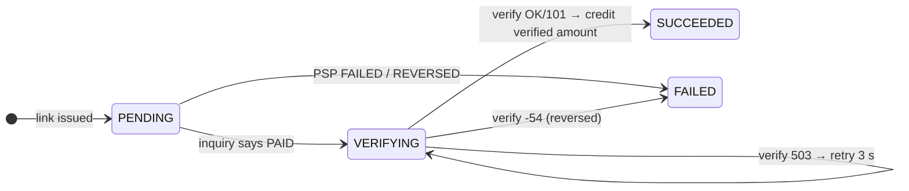
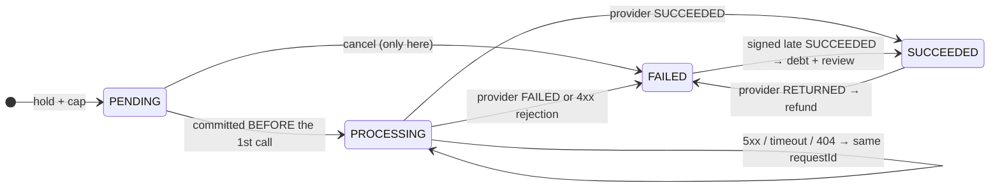

# HamtaPay Wallet & Ledger Service — Design

> Status: **v2** (updated after probing the provider; see `provider-notes.md`) · Scope: T-103 · Author: Amir
> Saffarzadeh · The change history is at the end.

## 1. Boundaries

The service is one **NestJS modular monolith** on **PostgreSQL**, and PostgreSQL is the *only* source of truth
for money. There is no Redis. Every invariant (balance ≥ 0, daily cap, idempotency, exactly-once posting) is
enforced inside one database transaction. So losing the broker, a cache or an instance can't lose or corrupt
money. The service runs as N stateless replicas (2 in compose), and all background work is coordinated through
the database.

| Module | Owns | Uses |
|---|---|---|
| `ledger` | Chart of accounts, journals, entries, materialised user balances. It is the **only writer** of ledger tables. | outbox |
| `wallets` | Balances and keyset-paginated history | ledger |
| `deposits` | Deposit lifecycle, PSP callback, poller | ledger, `PaymentGateway` port |
| `withdrawals` | Holds, daily cap, dispatcher, payout webhook, state machine, cancel | ledger, `PayoutGateway` port |
| `transfers`, `operations` | User→user transfers; manual adjustments (+ reversal), integrity check, review queue | ledger |
| `idempotency` | `Idempotency-Key` storage and replay for every money-moving POST | — |
| `outbox` → RabbitMQ | Transactional outbox, relay with publisher confirms, sample consumer with inbox de-dup | broker |
| `reconciliation` | Parses the settlement CSV and reports mismatches. It never fixes anything. | `PaymentGateway` |

## 2. Data model

All money is `BIGINT` in **minor units** (IRT: 1 Toman; USDT: 10⁻⁶) and `bigint` in TypeScript. **No float**,
and lint forbids `parseFloat`. External rails use **Rial**, so amounts are ×10 at the boundary.

| Table | Keys / columns | Constraints & indexes |
|---|---|---|
| `ledger_accounts` | `owner_user_id` (NULL = house account), `currency`, `kind`, `normal_side`, `balance` | UNIQUE NULLS NOT DISTINCT (owner, currency, kind). `CHECK balance ≥ 0`. The balance is materialised **only for user accounts**. House balances are derived from entries, so there's no hot row. |
| `ledger_journals` | `type`, `idempotency_ref`, `reference_type/id`, `reverses_journal_id` | **UNIQUE(idempotency_ref)**, so one business event is posted once. A trigger rejects UPDATE/DELETE. |
| `ledger_entries` | `journal_id`, `account_id`, `currency`, `direction`, `amount > 0`, `balance_after`, `owner_user_id` | FK(account_id, currency). A **deferred trigger** checks Σdebit = Σcredit per journal and currency. Append-only. Index **(owner_user_id, id DESC)**. |
| `deposits` | uuid, `amount`, `status`, `psp_token` UNIQUE, `psp_ref_id`, `verified_amount_rial`, `next_check_at` | Partial index on due rows |
| `withdrawals` | uuid (= payout `requestId`), `amount`, `fee`, `destination`, `status`, provider fields, `limit_day`, `limit_amount_irt`, `next_attempt_at`, journal ids | Partial index on due rows |
| `withdrawal_daily_usage` | PK(`user_id`, `day`), `used_irt ≥ 0` | Conditional upsert enforces the cap |
| `idempotency_keys` | PK(`scope`, `key`), `request_hash`, stored response | Written in the **same transaction** as the effect |
| `outbox_events` / `processed_events` | `event_id` / PK(consumer, event_id) | At-least-once publish, exactly-once apply |
| `transfers`, `adjustments`, `inbound_events`, `reconciliation_reports` | Business records, audit of every callback/webhook, reports | |

The chart of accounts is per currency. User accounts are `AVAILABLE` and `HELD` (liabilities), plus
`RECEIVABLE` (debt, an asset). House accounts are `PSP_CLEARING`, `PAYOUT_CLEARING`, `FEE_REVENUE` and
`OPS_ADJUSTMENTS`. A withdrawal request moves amount+fee from AVAILABLE to HELD, so the money can't be spent
twice.

| Event | Journal |
|---|---|
| Deposit verified | Dr PSP_CLEARING / Cr AVAILABLE (*verified* amount) |
| Withdrawal requested | Dr AVAILABLE (amount+fee) / Cr HELD |
| Withdrawal succeeded | Dr HELD / Cr PAYOUT_CLEARING (amount) + Cr FEE_REVENUE (fee) |
| Withdrawal failed / cancelled | Reversal of the hold (Dr HELD / Cr AVAILABLE) |
| Withdrawal returned after success | Dr PAYOUT_CLEARING (+ FEE_REVENUE) / Cr AVAILABLE |
| Transfer · Adjustment | Dr AVAILABLE(from) / Cr AVAILABLE(to) · Dr OPS_ADJUSTMENTS / Cr AVAILABLE (a mistake is fixed by a reversal journal) |

## 3. State machines (final states: `SUCCEEDED`, `FAILED`)

**Deposit.** The callback is only a trigger. We **never verify while the inquiry says INIT**, because verify
would answer FAILED and a payment made later would be lost. Missing callbacks are covered by the poller (≤ 30 s,
far inside the PSP's 10-minute reversal window). An unpaid deposit stays `PENDING`, because the PSP token never
expires. Polling stops after 24 h, but callbacks still work.

**Withdrawal.** Silence never fails a withdrawal. Before acknowledgement we re-POST the same `requestId` (the
provider de-duplicates). After it, we only GET, because a 404 lasts ~90 s after a 503 or timeout. Webhooks must
carry a valid HMAC over the raw body, and transitions are monotonic (stale or duplicate events are no-ops). After
30 min without an answer, the withdrawal is flagged `needs_review` and the funds stay held.

## 4. Invariants & how they hold

1. **Balance ≥ 0, no double spend:** one conditional `UPDATE … SET balance = balance + δ WHERE balance + δ ≥ 0`
   per account. Accounts are updated in id order, so there are no deadlocks. A `CHECK` constraint is the
   backstop.
2. **Daily cap under concurrency:** `INSERT … ON CONFLICT DO UPDATE … WHERE used + x ≤ cap` in the same
   transaction.
3. **Idempotency:** the key row is inserted in the business transaction. A concurrent duplicate blocks on the
   unique index, then replays the committed response. A business error is stored through a savepoint.
4. **Crash safety:** every step is a committed state. Workers claim rows with `FOR UPDATE SKIP LOCKED` and a
   lease (`next_attempt_at`). Every external call is idempotent by our id.

## 5. Assumptions

IRT is integer Toman and USDT has at most 6 decimals. The minimum withdrawal is 100,000 Toman (from the business
rules; the error table's "50,000" is read as an example). The minimum deposit is 1,000 Toman (the PSP minimum is
10,000 Rial). The USDT fee (1) is not part of the transfer and not counted in the cap. USDT is converted to Toman
at a configured rate, rounded up. A "day" is the Asia/Tehran day, from the DB clock. `/internal/*` is for the ops
network (with an optional API key).

## 6. Architecture decisions

**ADR-1 · Balance concurrency.** Options: a Redis lock; optimistic versioning with retry; `SERIALIZABLE`; a
conditional `UPDATE` in Postgres. **Chosen:** the conditional UPDATE plus CHECK. *Cost:* one very hot wallet is
limited by row-lock throughput (`scalability.md`). *Gain:* there's no second store whose failure or lag can
break the invariant.

**ADR-2 · Idempotency storage.** Options: Redis `SETNX`+TTL; a table with `IN_PROGRESS` and recovery; a row in
the *same* transaction as the effect. **Chosen:** the same transaction. *Cost:* deposit creation keeps its
transaction open during the bounded, side-effect-free PSP "create payment" call, and the keys live in the main
DB.

**ADR-3 · Unknown withdrawal outcome.** Options: fail after a timeout and release; hold until there's a
definitive answer. **Chosen:** hold. The `requestId` is deterministic, and we never re-create an acknowledged
transfer. *Cost:* funds can stay held for a long time, which needs an ops review queue.

**ADR-4 · Events.** Options: publish after commit; CDC; transactional outbox. **Chosen:** the outbox with a
relay (publisher confirms, durable queues declared by both sides) and a consumer inbox. *Cost:* one more table,
and one relay tick of latency.

## Change history

| Version | Change |
|---|---|
| v1 | Initial design from the brief, written before implementation. |
| v2 | After probing the provider: Rial↔Toman conversion at the boundary (PSP-1). Inquiry before verify, and the poller cadence tied to the 10-minute reversal (PSP-3/6). The callback amount is ignored; we credit the verified amount (PSP-4). Re-POST before ack and GET-only after ack, because of the 90 s 404 window (PO-3). IBAN checksum checked up front, because the provider validates asynchronously (PO-4). `RETURNED` after `SUCCEEDED` refunds the user, with a new migration and a return watch (PO-6). User `RECEIVABLE` account and late-success handling (ambiguity #1). Cancel only while PENDING (#3). The settlement parser handles the observed format (S-1). The broker topology is declared by the publisher too, because a topic exchange drops unrouted events. |
