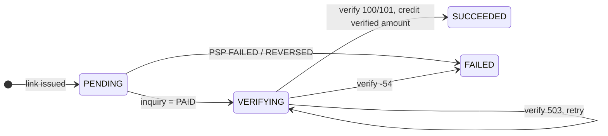
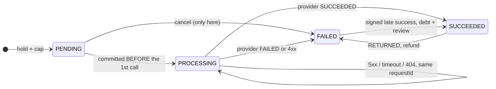

# HamtaPay Wallet & Ledger Service — Design

> **v2**, updated after probing the provider (`provider-notes.md`) · T-103 · Amir Saffarzadeh · change history at the end

## 1. Boundaries

The service is one **NestJS modular monolith** on **PostgreSQL**, and PostgreSQL is the *only* source of truth
for money. There is no Redis. Every invariant (balance ≥ 0, daily cap, idempotency, exactly-once posting) holds
inside one database transaction, so losing the broker or an instance can't lose money. N stateless replicas run
(2 in compose), and background work is coordinated through the database.

| Module | Responsibility |
|---|---|
| `ledger` | Chart of accounts, journals, entries, user balances. It is the **only writer** of ledger tables. |
| `wallets` | Balances and keyset-paginated history |
| `deposits` / `withdrawals` | Lifecycles, PSP callback / payout webhook, pollers, state machines, daily cap, cancel |
| `transfers` / `operations` | User→user transfer; manual adjustments (+ reversal), integrity check, review queue |
| `idempotency` | `Idempotency-Key` storage and replay for every money-moving POST |
| `outbox` → RabbitMQ | Transactional outbox + relay; sample consumer with inbox de-dup |
| `reconciliation` | Parses the settlement CSV and reports mismatches. It never fixes anything. |

The external services sit behind ports (`PaymentGateway`, `PayoutGateway`), so tests use deterministic fakes.

## 2. Data model

Money is `BIGINT` in **minor units** (IRT: 1 Toman; USDT: 10⁻⁶) and `bigint` in code. There are no floats.
External rails use **Rial**, so amounts are ×10 at the boundary.

| Table | Keys, constraints, indexes |
|---|---|
| `ledger_accounts` | UNIQUE NULLS NOT DISTINCT (owner, currency, kind). `CHECK balance ≥ 0`. The balance is materialised only for **user** accounts; house balances are derived (no hot row). |
| `ledger_journals` | **UNIQUE(idempotency_ref)**, so a business event posts once. `reverses_journal_id`. Append-only trigger. |
| `ledger_entries` | `amount > 0`, `balance_after`, FK(account, currency). **Deferred trigger: Σdebit = Σcredit** per journal and currency. Index (owner_user_id, id DESC). |
| `deposits` / `withdrawals` | uuid PK (the withdrawal id = payout `requestId`), status, provider fields, journal ids, `next_*_at` (partial index on due rows) |
| `withdrawal_daily_usage` | PK(user_id, Tehran day), `used_irt ≥ 0` |
| `idempotency_keys` | PK(scope, key), request hash, stored response, written **in the effect's transaction** |
| `outbox_events` / `processed_events` | Event id; publish at-least-once, apply once |
| `transfers`, `adjustments`, `inbound_events`, `reconciliation_reports` | Business records, audit of every callback/webhook, reports |

Accounts per currency: user `AVAILABLE` and `HELD` (liabilities), `RECEIVABLE` (debt), and house accounts
`PSP_CLEARING`, `PAYOUT_CLEARING`, `FEE_REVENUE`, `OPS_ADJUSTMENTS`. The journals:
deposit `Dr PSP_CLEARING / Cr AVAILABLE` (verified amount) ·
withdrawal request `Dr AVAILABLE / Cr HELD` (amount+fee) ·
success `Dr HELD / Cr PAYOUT_CLEARING + Cr FEE_REVENUE` ·
failure or cancel = reversal of the hold ·
return after success `Dr PAYOUT_CLEARING / Cr AVAILABLE` ·
transfer `Dr AVAILABLE(a) / Cr AVAILABLE(b)` ·
adjustment `Dr OPS_ADJUSTMENTS / Cr AVAILABLE` (a mistake is fixed with a reversal journal).

## 3. State machines (final states: `SUCCEEDED`, `FAILED`)

**Deposit.** The callback is only a trigger. We **never verify while the inquiry says INIT**: verify would
answer FAILED, and a payment made later would be lost. The poller (≤ 30 s) covers lost callbacks, well inside
the PSP's 10-minute reversal window.

**Withdrawal.** Silence never fails a withdrawal. Before the provider acknowledges it, we re-POST the same
`requestId` (the provider de-duplicates). After that we only GET, because a 404 lasts ~90 s after a 503 or
timeout. Webhooks need a valid HMAC over the raw body. Transitions are monotonic, so stale or duplicate events
are no-ops. After 30 min without an answer the withdrawal is flagged `needs_review`, and the funds stay held.

## 4. How the invariants hold

1. **Balance ≥ 0 and no double spend:** `UPDATE … SET balance = balance + δ WHERE balance + δ ≥ 0` per account,
   in id order (no deadlocks), with a CHECK constraint as the backstop.
2. **Daily cap:** `INSERT … ON CONFLICT DO UPDATE … WHERE used + x ≤ cap` in the same transaction.
3. **Idempotency:** the key row is in the business transaction. A concurrent duplicate waits on the unique
   index, then replays the response. A business error is stored through a savepoint.
4. **Crash safety:** every step is a committed state. Workers claim rows with `FOR UPDATE SKIP LOCKED` + a
   lease, and every external call is idempotent by our id.

## 5. Assumptions

IRT is integer Toman; USDT has ≤ 6 decimals. Minimum withdrawal 100,000 Toman (the business rules; the error
table's "50,000" is an example). Minimum deposit 1,000 Toman (the PSP minimum is 10,000 Rial). The 1 USDT fee
isn't counted in the cap. USDT is converted to Toman at a configured rate, rounded up. The day is the
Asia/Tehran day, from the DB clock. `/internal/*` is reached from the ops network (optional API key).

## 6. Architecture decisions

**ADR-1 · Balance concurrency.** Options: Redis lock · optimistic version + retry · SERIALIZABLE · conditional
UPDATE. **Chosen:** conditional UPDATE + CHECK. *Cost:* one very hot wallet is limited by row-lock throughput
(`scalability.md`). *Gain:* no second store whose failure can break the invariant.

**ADR-2 · Idempotency storage.** Options: Redis SETNX+TTL · a table with IN_PROGRESS + recovery · the same
transaction as the effect. **Chosen:** the same transaction. *Cost:* deposit creation keeps its transaction
open during the bounded, side-effect-free PSP "create" call; the keys live in the main DB.

**ADR-3 · Unknown withdrawal outcome.** Options: fail after a timeout · hold until a definitive answer.
**Chosen:** hold, with a deterministic `requestId`, and never re-create after acknowledgement. *Cost:* funds can
stay held for a long time, so ops needs a review queue.

**ADR-4 · Events.** Options: publish after commit · CDC · transactional outbox. **Chosen:** the outbox with
confirmed publishing and a consumer inbox. *Cost:* one more table and one relay tick of latency.

## Change history

| Version | Change |
|---|---|
| v1 | Initial design from the brief, written before implementation (first commit). |
| v2 | After probing the provider: Rial↔Toman at the boundary (PSP-1); inquiry before verify, and polling tied to the 10-minute reversal (PSP-3/6); the callback amount is ignored (PSP-4); re-POST before ack, GET after it (90 s 404 window, PO-3); IBAN checksum checked up front (PO-4); RETURNED refunds, with a new migration and a return watch (PO-6); a RECEIVABLE account + late-success handling (ambiguity #1); cancel only while PENDING (#3); a settlement parser for the observed format (S-1); the publisher declares the durable queues (a topic exchange drops unrouted events). |
